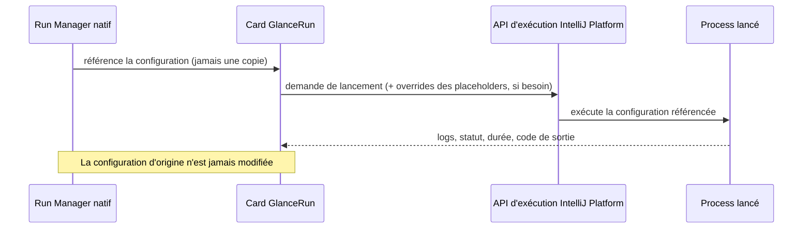

# GlanceRuns : garde un œil sur tes runs en arrière-plan sans y laisser tes yeux

> Aujourd'hui, pas de tuto, pas de Chocabugs©, pas d'anecdote qui part dans tous les sens. Je sors la tête du Markdown pour une annonce : je viens de publier mon premier plugin IntelliJ Platform, et j'ai trop hâte de t'en parler pour attendre la prochaine série Spring.

Depuis que je développe, il y a toujours eu, quelque part sur mon poste, un ou deux processus qui tournent en arrière-plan sans que je les regarde vraiment : une suite de tests d'intégration, un bundle Capacitor, un déploiement local, un script de seed de base de données. Je les lance, je change d'onglet, je retourne coder, et dix minutes plus tard je me demande *"c'est fini ? ça a planté ? c'était lequel, déjà ?"*.

J'ai fini par en avoir assez de garder une console plein écran allumée juste pour vérifier qu'un run tourne encore, ou de perdre le fil entre cinq onglets de Run Manager. Alors, comme souvent, je me suis construit l'outil qu'il me manquait. Il s'appelle **GlanceRuns**, et je le partage aujourd'hui avec toi.

<!--truncate-->

[](https://plugins.jetbrains.com/plugin/36221-glanceruns/) [](https://plugins.jetbrains.com/plugin/36221-glanceruns/)

## Le problème que GlanceRuns résout

**Un `Run`/`Debug` qui dure plus de quelques secondes finit toujours par sortir de ton champ de vision.** Tu le lances, tu passes à autre chose, et tu perds le fil :

- Tu gardes une console en plein écran "juste au cas où", ce qui te bouffe de l'espace d'édition pour rien.
- Tu as plusieurs runs longs en parallèle (tests, build, déploiement local...) et tu ne sais plus lequel est terminé, lequel a planté, lequel tourne encore.
- Tu dois rouvrir le Run Manager, retrouver le bon onglet de console, et scroller dans les logs pour savoir "où ça en est".

GlanceRuns ne remplace pas ton Run Manager natif, **ce n'est ni un terminal, ni un gestionnaire de configurations de plus**. C'est une surcouche de surveillance visuelle : tu continues à définir et éditer tes Run/Debug Configurations exactement comme avant, et GlanceRuns t'en donne juste un aperçu permanent, en mosaïque, sans monopoliser ton écran.

## GlanceRuns, en une phrase

Voici la description officielle, celle que tu retrouveras sur la fiche [JetBrains Marketplace](https://plugins.jetbrains.com/plugin/36221-glanceruns/) :

> *A mosaic run manager: visually monitor your long-running commands (promoted Run/Debug Configurations) without keeping a full-size console permanently on screen.*

**Le principe central, c'est "référence, pas copie".** Quand tu promeus une Run/Debug Configuration existante en "card" GlanceRuns, le plugin ne la duplique jamais. Il la référence, et l'exécute via les API d'exécution natives de l'IntelliJ Platform. Ta configuration reste éditable normalement dans le Run Manager natif, et tout ce que tu y modifies est repris au lancement suivant depuis GlanceRuns.



```text title="Le code pour le diagramme ci-dessus"
sequenceDiagram
    participant RM as Run Manager natif
    participant GR as Card GlanceRun
    participant API as API d'exécution IntelliJ Platform
    participant P as Process lancé

    RM->>GR: référence la configuration (jamais une copie)
    GR->>API: demande de lancement (+ overrides des placeholders, si besoin)
    API->>P: exécute la configuration référencée
    P-->>GR: logs, statut, durée, code de sortie
    Note over RM,GR: La configuration d'origine n'est jamais modifiée
```

:::info Et le nom, alors ?
Une card promue s'appelle une **GlanceRun**, invariable au pluriel (on dit "trois GlanceRun", pas "GlanceRuns" — oui, je sais, c'est tentant). Je l'ai déposé... mentalement, hein, soyons clairs.
:::

## Comment ça marche concrètement

### Promouvoir un run existant, ou en créer un nouveau

- **Promotion d'une configuration existante** : un bouton `+` dans le tool window GlanceRuns, ou l'action "Promouvoir vers GlanceRun..." dans le menu `Tools`, et ta configuration apparaît en mosaïque.
- **Création rapide d'une nouvelle configuration** directement depuis GlanceRuns, via le dialog natif "Edit Configurations...", automatiquement promue dès sa création.
- **Une même configuration peut être promue plusieurs fois** (les instances sont auto-suffixées), pratique pour lancer la même commande avec des paramètres différents côte à côte.

### Des paramètres sans jamais toucher à ta configuration

- Tu peux placer des **placeholders du type `{{NOM}}`** dans les "Program arguments" de ta Run Configuration.
- Au lancement depuis GlanceRuns, une popup te demande de les remplir.
- Le plugin **clone la configuration en mémoire** (jamais sur disque) pour injecter les valeurs : ta configuration d'origine n'est jamais modifiée.

### Un suivi visuel qui ne t'impose rien

- Chaque card affiche une **miniature des logs** (sortie ANSI colorée comprise), et s'ouvre en vue agrandie pour retrouver la console native complète de l'IDE, le statut, la durée, l'heure de fin et le code de sortie.
- **Pastille de statut colorée** et icône du type de Run Configuration sur chaque card, pour identifier un run d'un coup d'œil.
- **Notifications de fin de run**, pour ne jamais rater la fin d'un process sans garder l'œil collé à l'écran.
- **Trois layouts** au choix : liste, 2 colonnes, 3 colonnes.
- **Réorganisation des cards par glisser-déposer**, ou par boutons Monter/Descendre si tu préfères (ou si tu en as besoin) au clavier.

### Des garde-fous qui évitent les mauvaises surprises

- Un **avertissement avant de supprimer une card dont le run est actif**.
- Un **avertissement à la fermeture de l'IDE** s'il reste des runs actifs en cours.
- Si la Run Configuration référencée par une card **disparaît** (supprimée ou renommée), la card bascule en état "Missing" avec une icône de chaîne brisée, et une popup te propose de la rattacher à une nouvelle configuration.
- Les **"before-launch tasks"** (par exemple un Build avant lancement) sont exécutées exactement comme pour un Run natif.

:::tip L'astuce de ton Dev Sensei
Le dialog "Paramètres du GlanceRun" garde toujours un lien visible vers la Run Configuration référencée, avec un accès direct à son édition native. Tu peux aussi choisir de synchroniser (ou non) le nom affiché de la card avec celui de la Run Configuration — utile si tu renommes souvent tes configs sans vouloir perdre le nom "parlant" que tu as donné à ta card.
:::

## Compatibilité, gratuité et vie privée

**GlanceRuns est compatible avec l'IntelliJ Platform 2025.3.5 et les versions compatibles** : IntelliJ IDEA, bien sûr, mais aussi tout IDE basé sur la même plateforme.

**Le plugin est actuellement gratuit, et il ne collecte aucune donnée personnelle ni télémétrie : il ne fait strictement aucun appel réseau.** Tous les détails (y compris la possibilité, assumée, d'introduire des fonctionnalités payantes à l'avenir avec préavis pour les utilisateurs déjà actifs à ce moment-là) sont dans l'EULA publique du plugin, sur ce site : [GlanceRuns — EULA](/glance-runs/EULA).

J'édite GlanceRuns à titre personnel, pas via une société. C'est un projet perso, construit pour résoudre mon propre problème, que je publie pour qu'il te serve aussi.

:::info Testé avant de sortir
GlanceRuns embarque aujourd'hui 86 tests automatisés (persistance des cards, exécution, logs, cycle de vie, rattachement d'une configuration manquante, rechargement d'état...), en plus de vérifications manuelles en sandbox avant chaque publication. Rien ne remplace tes retours, mais je ne te lâche pas un plugin non testé dans la nature.
:::

## Où le récupérer

La fiche du plugin est en ligne sur le [JetBrains Marketplace](https://plugins.jetbrains.com/plugin/36221-glanceruns/). Tu peux l'installer directement depuis les paramètres de plugins de ton IDE (`Settings` → `Plugins` → `Marketplace`), en cherchant "GlanceRuns".

J'ai aussi monté une [page de présentation complète](/glance-runs) sur ce site, avec le guide d'utilisation détaillé (en français et en anglais) et l'EULA.

## Pour conclure

GlanceRuns part d'un besoin très simple : surveiller des commandes longues sans sacrifier mon espace d'édition ni perdre le fil de ce qui tourne où. Le plugin ne copie jamais tes configurations, se contente de les référencer, et te laisse le contrôle total côté Run Manager natif.

C'est la version 1.0.0, pas la version finale. Je compte la faire évoluer avec les retours des gens qui l'utiliseront vraiment, toi inclus si tu l'essaies. Si tu as une idée, une config qui ne se comporte pas comme attendu, ou juste envie de me dire ce que tu en penses, les commentaires sont ouverts.

---

Merci d'avoir pris le temps de lire cet article ! J'espère qu'il t'aura été utile et que tu as appris quelque chose de nouveau.

Si tu as envie que j'explique plus avant certains concepts ou que je parle de quelque chose en particulier, n'hésite pas à me le dire dans les commentaires.

Pour ne pas rater les prochains articles, abonne-toi à un flux (tu as le choix entre [RSS](https://dev-sensei.digicrafters.fr/blog/rss.xml), [Atom](https://dev-sensei.digicrafters.fr/blog/atom.xml) et [Json](https://dev-sensei.digicrafters.fr/blog/feeed.json)) ou à la newsletter en [page d'accueil](/) !
